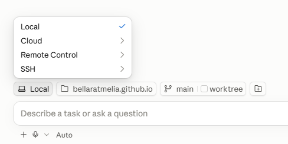
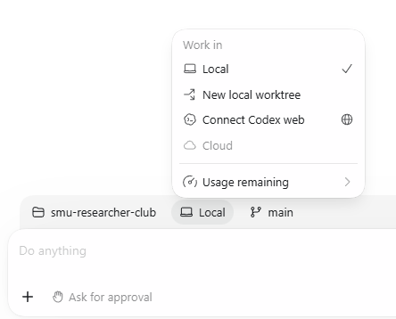
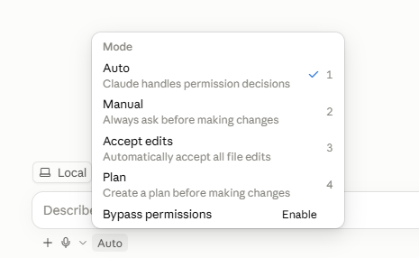
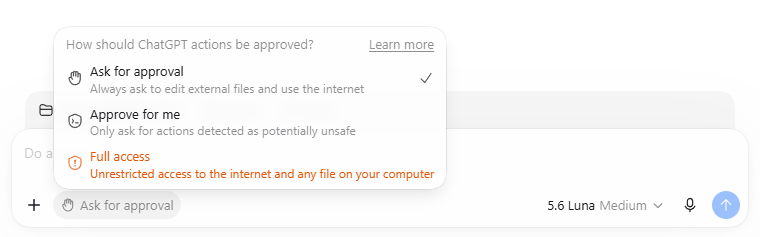

## By the end of today, you'll be able to

- Hand an AI agent a research task on **your own files**
- **Check** the sources and codes it brings back
- Turn what worked into a **procedure you can reuse and defend**

::: {.notes}
[0:00] Welcome, introduce yourself in one line (librarian at SMU Libraries, supporting researchers with data and digital tools) and thank the professor.

Then this promise, slowly. These three lines are the whole session: Parts 1 and 3 are the first line, Part 2 and the human coding check in Part 3 are the second, Part 4 is the third.

While people settle: "If you haven't opened Claude Code or Codex yet, start it now. The first hands-on bit is in about 25 minutes."
:::

## Today

1. Core concepts, and a tour of Claude Code / Codex 
2. Finding sources and extracting summary for literature review 
3. Coding with a codebook: field notes, then a whole chat export
4. Making it reproducible: logs, scripts, Skills


::: {.notes}
The overarching idea for the whole session: what can the AI reach, and how do you steer it?

Say it out loud and slowly. It's the question we come back to at every section break.

Walk through the parts in one breath each:

- Part 1: what an agent is, and a short tour of the tool.
- Part 2: using it to find sources, and checking them.
- Part 3: coding field notes with a codebook, you and the AI, then the same logic on the group's whole chat export.
- Part 4: making sure you can repeat it and defend it.

Then the close.

Run sheet (core ends by 8:30; anything after is bonus):

- 6:30–6:38 Opening and calibration
- 6:38–7:03 Part 1 and first task
- 7:03–7:23 Part 2: literature discovery and checking
- 7:23–7:28 Short break / reset (use it as buffer if behind)
- 7:28–8:03 Part 3: field-note coding, human check, then scale
- 8:03–8:23 Part 4: logs, reproducibility, Skills
- 8:23–8:30 Integrity and take-home
- After 8:30, if the room has time: questions, live Skill demo, Git, troubleshooting

If time slips, cut in this order: Remote/SSH (already gone) → modes table (just say "start in Plan") → live connector setup → API-key code (say the warning) → "Level up" → live Skill creation (show the finished SKILL.md).

Never cut: the first task, checking real references, Try 3 (code it yourself), the "before you give it research material" slide, the research log, the final accountability line.
:::


## A note before we begin

- **Practitioner-led**: what I've learned supporting researchers
- Tools change **fast**. The **mental model** shouldn't
- Research **methods**: your professor's call

::: {.keypoint}
Questions and corrections welcome. Let's make it two-way exchange!
:::

::: {.notes}
[~30 sec] Keep this short. The essential version: "I support researchers using data and digital tools. Today is practitioner-led, not a research-methods lecture. Tools will change, but the questions of access, steering, verification and accountability will stay."

The full version of each point, only if the room wants it:

- Practitioner-led: this is based on what I've learned from experimenting with these tools in my day-to-day work supporting researchers.
- The tools and practices are evolving quickly. Some of what I show will look different by next semester, and some of you may know parts of it better than I do. Today is about a mental model that should survive the next few product updates.
- Anything related to research methods is strictly in the domain of your professor.
- Questions, corrections and lessons from your own experiments are welcome.

Or paraphrase:

"I'm not a methods person and I'm not selling a product. I support researchers, and I've spent a lot of time breaking these tools so you don't have to. Menus will change. The way of thinking about them shouldn't."

On methods: "If anything I say about method conflicts with what your professor says, your professor wins."

:::


## Where are you now?

Quick show of hands:

::: {.incremental}

1. I've used ChatGPT, Claude, Gemini or Copilot **at least once**
2. I use one of them **every week**
3. I've connected one to **another app** (Drive, Zotero, a database)
4. I've had one **run code** or **edit files** for me

:::

::: {.notes}
[~1 min] Ask each one and keep hands up as you go. Expect most hands on 1 and 2, a few on 3, very few on 4.

Read the room out loud: "So most of us are here [1–2]. Today is about getting from here to here [3–4]."

If many hands go up on 4, say you'll go faster through the tour and spend more time on Parts 3 and 4.
:::


## Checklist

Ideally, before today you have:

- ✓ **Claude Code** or **Codex** installed and logged in (both need a paid plan)
- ✓ Laptop and charger

<br>

No Claude Code or Codex? Pair up and take a role:

- **Driver**: has the tool, runs the workflow
- **Reviewer**: reads the plan, challenges the output, checks sources, approves or rejects

::: {.notes}
[~30 sec] Say it quickly; don't read the list.

Frame the reviewer role as real work, not a consolation: "Reviewing is the job the rest of today is about. The reviewer is the one who says yes or no." Swap roles between activities if both people have access.

Everything I show is in the materials, so anyone can redo it later.
:::

## A ground rule

::: {.big}
If you can't defend it without the AI in the room, you're not done.
:::

::: {.notes}
[~30 sec] Read it, then pause. Let it land.

"Imagine your examiner or a reviewer asks: why did you include this paper, why is this code applied here? 'Claude said so' isn't an answer. Everything today is about getting to an answer you can give yourself."

This line comes back at the very end.
:::


# Part 1: Core concepts {.section}


::: {.notes}
[~0:08] Part 1, about 25 minutes, including a 5-minute hands-on.
:::

## Words I'll use: the agent

| Term | What I mean | Not to be confused with |
|---|---|---|
| **Model** | The AI itself (Claude, GPT). Reads text, writes text | The app you open |
| **Harness** | The app around the model (Claude Code, Codex, claude.ai). Decides what it can see, touch and run | The model. Same model, different harness, different abilities |
| **Agent** | Model + harness, working through a task in steps | Fully autonomous. You set the task and check the work |
| **Context** | Everything the model can see in this session | Long-term memory. A new session starts (mostly) fresh |

::: {.notes}
[~2 min] Why this slide: these words get used loosely online, and I want us to mean the same thing by them for the next two hours.

Say up front: "I'm giving you a few labels now. Don't try to memorise them. The first activity will make them concrete, and I'll point back."

This is a reading slide, so pause and let people read before talking.

The key distinction is model vs harness. "Claude" can mean the model or the app. Same model in claude.ai and in Claude Code; the harness is what changes what it can do. That's the whole "chat vs agent" difference coming up in a few slides.

Context gets its own slide later (the desk).
:::

## Words I'll use: what you plug in

| Term | What I mean | Not to be confused with |
|---|---|---|
| **Tool** | One action the harness allows: read a file, run code, search | An app you install |
| **Connector (MCP)** | A plug-in that gives the agent tools for an outside source: PubMed, Zotero, Drive | Uploading a file. It searches the live source |
| **Skill** | Saved instructions for a recurring task, in a `SKILL.md` file | A prompt you retype. It's written once and reused |

::: {.notes}
[~1.5 min] Tools are the verbs: the individual things the agent can do. The harness decides which tools exist.

Connectors add tools that reach outside your computer. MCP is just the standard name for how they plug in; you'll hear both words.

Skills don't add abilities. They add your procedure: how you want a task done.

One-line summary to say out loud: "The harness gives it tools, connectors give it reach, Skills give it your method."
:::

## What can the AI reach, and how do you steer it?

Most of us are familiar with the **I type, it answers** pattern.

Three new ideas today:

| | The idea | What it means for you |
|---|---|---|
| **It can act** | Agents plan and take steps, not just reply | Hand over a task, not just a question |
| **It can reach things** | Connectors open your files, databases, tools | Answers grounded in real sources, not memory |
| **It can follow your procedures** | Skills hold your instructions, written once | The same method, every time |

::: {.notes}
[~2 min] This slide is the map for the whole session.

- "It can act": that's the agent idea, the next few slides.
- "It can reach things": connectors, end of Part 1, used in Part 2.
- "It can follow your procedures": Skills, planted at the end of Part 1, built in Part 4.

"Steering" is the right-hand column: you decide the task, the sources and the procedure.
:::

## Chat vs agent

::: {.columns}
::: {.column width="50%"}
### A chatbot
is a **consultant you email**.

- You send a question, it sends back an answer
- It only knows what you paste in and what it learned in training
- You do all the legwork in between
:::
::: {.column width="50%"}
### An agent
is a **research assistant you hand a task to**.

- It has a desk, files and tools
- It works through several steps on its own
- It reports back, and you check the work
:::
:::

::: {.notes}
Same underlying model in both cases. What's different is what it's allowed to touch and whether it can take more than one step before coming back to you. In glossary terms: same model, different harness.

[~2 min] Lean on the analogy: most people here have supervised or been an RA. "You wouldn't take an RA's literature table without spot-checking it. Same here."

The "desk" comes back on the context slide.
:::

## In practice: web chat vs Claude Code / Codex

| Web chat (Claude.ai / ChatGPT.com) | Claude Code / Codex |
|---|---|
| Runs in a browser | Runs on **your computer**, in **your project folder** |
| Sees only what you paste or upload | Reads many files and sees how they relate |
| Hands you text and code to copy back | Creates, edits and organises files itself |
| You run the output yourself | Runs scripts and commands, **with your permission** |
| Best for questions and one-off outputs | Best for multi-step work: act, check, continue |

::: {.notes}
[~1.5 min] Don't read the table row by row. Pick two rows:

- "Runs on your computer, in your project folder." That's the big shift.
- "Runs scripts, with your permission." That's why we'll talk about modes in a minute.
:::

## More access, not "better"

::: {.caution}
Claude Code and Codex aren't automatically **better** than web chat. They have more **access** and more ability to **act**, which is why permissions, checkpoints and your review matter.
:::

::: {.notes}
[~30 sec] Say it plainly: more access means more ways for things to go wrong. Web chat is still the right tool for a quick question.

This is the fence for the whole session: an agent isn't a smarter chatbot, it's the same model with more reach.
:::

## Before you give it research material {.smaller}

| Ask | Think about |
|---|---|
| **May I use it?** | Consent, ethics approval, platform expectations, confidentiality |
| **May this tool receive it?** | Institutional approval, provider terms, retention and training settings |
| **What's the minimum it needs?** | De-identify, minimise, or use fictional / synthetic material |
| **What must stay with me?** | Interpretation, contextual judgement, inclusion decisions, final claims |

::: {.caution}
**"Local" ≠ private.** The files stay on your machine, but what the agent reads is sent to the model provider.

**Public ≠ unrestricted.** Publicly visible posts aren't automatically ethically unrestricted, context-free, or fine to send to a third-party model.
:::

::: {.notes}
[~2 min] This comes before any tool demo on purpose. For ethnographers, ethics isn't a closing caution; it decides whether the workflow should happen at all.

Walk the four questions top to bottom. The first two are "should this go in at all?", the third is "how little can I send?", the fourth is "what never gets handed over?".

On "public ≠ unrestricted": "Most of you will hear 'but it was public' from someone this year. Public to the group members who posted it is not the same as public to a model provider." Defer specifics to the professor and your IRB.

Everything we use today is fictional, written for teaching, so we can skip the first three questions. With your real field notes, you can't.
:::

## The agent loop

```{=html}
<div style="display:flex;gap:0.5em;align-items:stretch;font-size:0.7em;margin-top:1em">
  <div style="flex:1;border:2px solid var(--ocean);border-radius:var(--radius-md);padding:0.6em;background:var(--surface-raised)"><b>Plan</b><br>Break the task into steps</div>
  <div style="align-self:center">→</div>
  <div style="flex:1;border:2px solid var(--ocean);border-radius:var(--radius-md);padding:0.6em;background:var(--surface-raised)"><b>Act</b><br>Search, read a file, run code</div>
  <div style="align-self:center">→</div>
  <div style="flex:1;border:2px solid var(--ocean);border-radius:var(--radius-md);padding:0.6em;background:var(--surface-raised)"><b>Observe</b><br>Look at what came back</div>
  <div style="align-self:center">→</div>
  <div style="flex:1;border:2px solid var(--ink);border-radius:var(--radius-md);padding:0.6em;background:var(--mist)"><b>Adjust</b><br>Fix, retry, or move on</div>
  <div style="align-self:center">↺</div>
</div>
```

<br>

- A chatbot does **one** pass. An agent goes round this loop until it thinks it's finished.
- "Thinks it's finished" is the catch. **You** decide when it's actually finished.

::: {.notes}
We'll see the loop live in Part 3, when the script hits an error and the agent fixes it. Point back to this slide then.

[~2 min] Example to talk through: "Find the CSV, count the rows. Oops, the year column has text in it. Clean that, count again."

Stress the second bullet. Agents are confident about being finished. That's where you come in.
:::

## Context: the agent's working memory

Think of **context** as the agent's desk.

- Everything goes on the desk: instructions, files, results, replies
- The desk is **big but not infinite**
- Long sessions **drift**: early rules get buried

::: {.keypoint}
**Habits:** fresh session per task · instructions in a **file** · ask for a progress summary
:::

::: {.notes}
[~2 min] Back to the desk from the chat-vs-agent slide.

The full version: everything in the session sits on the desk (your instructions, files it read, search results, its own replies). As the pile grows, early instructions get buried, which is why it "forgets" a rule you set an hour ago. Put important instructions in a file (or a Skill), not in message 3 of 40.

Ask: "Has anyone had a long chat where it started ignoring something you told it earlier?" Expect nods. That's context.

The habit that matters most for researchers: write instructions in a file. It's also the bridge to Skills later.
:::

## Where the code runs

The useful question isn't "which product?" but **where does it run, and what can it touch?**

| Option | Where it runs |
|---|---|
| **Local** | Your computer: your files, your terminal. The default, and what we use today |
| **Cloud** | The provider's machine. Good for long tasks; starts from a fresh copy, so it can't see your local folders |

::: {.notes}
[~1 min] Back to "what can it reach?": the answer depends on where it runs.

Today: local. Cloud is worth knowing about for long jobs, but it can't see your laptop's folders.

Either way, the content it reads goes to the model provider (previous "before you give it research material" slide).

If someone asks about lab servers: both tools can also run on another machine over SSH. Not needed today.
:::

## Where to pick it

::: {.columns}
::: {.column width="55%"}
{width="100%"}
:::
::: {.column width="45%"}
{width="100%"}
:::
:::

[Left: Claude Code desktop. Right: Codex. Menus change often; checked October 2026.]{.small .muted}

::: {.notes}
[~30 sec] Show the menu live in the app rather than pointing at the screenshot. This slide is the backup if the live app misbehaves.
:::

## Tour: how much should it ask you?

| Mode | What it does |
|---|---|
| **Plan** | Investigates and writes a plan **before** changing anything |
| **Manual** | Asks before every action that changes something |
| **Accept edits** | File edits go through; other actions still ask |
| **Auto** | Proceeds on safe actions, pauses on riskier ones |
| **Bypass** | Never asks. **Not for today** |

::: {.notes}
Codex calls these approval settings: Ask for approval, Approve for me, Full access. Same idea.

[~1.5 min] This is "how do you steer it?" Modes are a dial from "check everything" to "trust everything".

If running behind: skip the table, go straight to the next slide and just say "start in Plan".
:::

## Tour: start in Plan mode

::: {.columns}
::: {.column width="50%"}
{width="100%"}
:::
::: {.column width="50%"}
{width="100%"}
:::
:::

[Left: Claude Code. Right: Codex.]{.small .muted}

::: {.keypoint}
**For research work, start in Plan mode.** Read the plan the way you'd read a research assistant's proposal, then let it act.
:::

::: {.notes}
[~1 min] Show where the mode switch is in the app, live. Everyone set Plan mode now, ready for the next slide.
:::

## Tour: first task {.activity background-color="var(--mist)"}

[TRY · 5 min · Plan mode]{.chip .chip-try}

Open the workshop folder in Claude Code or Codex, then:

```text
Look at fieldwork-log.csv. Count my fieldwork entries by month and
type, make a bar chart, and save it as fieldwork-by-month.png. Then
add a two-line note to README.md saying what you did and when.
```

Look for:

- It **plans** before acting
- It **reads** the actual file instead of guessing
- It **leaves things behind**: a chart and a note, in your folder

::: {.notes}
Show-and-tell fallback: I run it on screen. Keep to 5 minutes. Don't teach terminal commands; the desktop apps avoid most of that. The point is: an agent on your own machine works on your files and leaves a record.

The file is materials/data/fieldwork-log.csv: a fictional fieldwork log for the same Telegram hawker group as the field notes (40 entries, March to May 2026, columns fieldnote_id, date, site, type, minutes). FN-01 to FN-06 match the excerpts in fieldnotes.md. Expected result: March 9 entries, April 17, May 14; mostly observation, a few archive and interview.

Frame it: "This is the kind of file you already keep. The agent is working on your records, not the internet."

Start the timer. Walk around. Common snags: folder not opened, not logged in, permission prompt they don't understand ("say yes, it's asking to write a file").

When the time is up, ask one person: "Did it plan first? Did you approve the plan?" Then open the chart and the README on screen.

Name what they just met, pointing back to the glossary: the model wrote the plan, the harness asked your permission, reading the CSV and saving the chart were tools, and the CSV was on its desk (context).
:::

## Connectors: USB-C ports for AI

::: {.columns}
::: {.column width="55%"}
- A **connector** plugs the AI into a source: PubMed, a scholarly index, Google Drive, Zotero
- **MCP** (Model Context Protocol) is the **standard** behind them, like USB-C is the standard behind the cable
- You don't need to build one. You need to know they **exist** and what each one can **reach**
:::
::: {.column width="45%"}
**Without a connector:** the AI answers from training memory, which is out of date and can invent sources.

**With a connector:** it searches a live source and can show you **where** each result came from.
:::
:::

::: {.caution}
A connector acts **with your access**. Treat it like a browser extension: know who made it before you switch it on.
:::

::: {.notes}
Claude Code: connectors added to your claude.ai account are available when you log in with that account; you can also add MCP servers per project. Codex: MCP servers are added in its settings. Check both the week before.

[~3 min] The key line: "You don't need to build one." People hear "protocol" and switch off. If running behind, skip the live setup mechanics; the setup steps are in the materials.

Stress the right column: memory vs a live source. That's the whole of Part 2 in one contrast.
:::

## Skills: the lab protocol card

A **Skill** is a set of instructions, written once, that the AI follows every time you do that task.

- Like an **SOP** or a **lab protocol**: the steps, the rules, the edge cases
- Research examples:
  - a **coding scheme** for field notes or interviews
  - your **screening criteria** for a literature review
  - your department's **citation style** quirks

::: {.keypoint}
This is the most transferable idea today. A Skill makes your AI use **consistent** and **reproducible**, and it's something you can show a reviewer.
:::

::: {.notes}
Just plant the idea here. We build one at the end of Part 4, from the field-note coding we do in Part 3.

[~2 min] For this audience, the best example is a coding scheme or interview-coding guide: "You already write these for human coders. A Skill is the same document, written for the AI."

Recap Part 1 in one line before moving on: an agent acts, connectors let it reach things, Skills steer it.
:::

# Part 2: Finding sources and extracting summary for literature review {.section}


::: {.notes}
[~0:33] Back to the question: what can it reach? Now we point it at the literature.
:::

## Why connectors matter for a lit review

Ask a plain chatbot for references and you'll often get:

- Real authors, plausible title, **paper doesn't exist**
- Real paper, **wrong year or wrong journal**
- Real paper, but it **doesn't say what the AI claims**

::: {.caution}
A connector improves **provenance**: you can see where a result came from. It doesn't show that the source **supports the claim**. Finding, coverage and interpretation are separate checks.
:::

::: {.notes}
[~2 min] Three ways a reference goes wrong, from most to least obvious. The third is the dangerous one: the paper exists, so a quick check passes, but it doesn't support the claim.

The caution box is the headline for Part 2. Don't let anyone leave with "connector = safe literature search". A connector fixes the first problem (made-up papers) far more than the third (papers that don't say what the AI claims).

If you have a real (anonymised) example from a consultation, tell it here. A story beats the bullet list.
:::

## What can it reach?

| Source | Covers | Connect via |
|---|---|---|
| **PubMed** | Biomedical and life sciences | Connector directory |
| **Consensus** | Broad, built on Semantic Scholar / OpenAlex data | Connector directory |
| **alphaXiv** | arXiv preprints | Connector directory |
| **Zotero** | **Your own** saved library | Community MCP server |
| **Your library's databases** | Licensed content (Scopus, WoS, publisher platforms) | Mostly **not** reachable. Use the library |

[Directory checked October 2026. Re-check the week of the session.]{.small .muted}

::: {.notes}
Library angle worth stressing: connectors mostly reach open indexes. Paywalled full text and licensed databases are usually out of reach, so "the AI didn't find it" often means "the AI couldn't see it". The library's discovery tools and librarians are still part of the workflow.

[~2 min] For ethnographers specifically: a lot of the relevant work is in books, edited volumes and regional journals, which open indexes cover poorly. Expect gaps.
:::

## How to switch on a connector {.smaller}

::: {.columns}
::: {.column width="50%"}
### Claude Code

1. In a browser, go to **claude.ai/customize/connectors**
2. Find the connector (e.g. Consensus, PubMed) → **Connect**, and sign in if asked
3. In Claude Code, type **`/mcp`** and check it says **Connected**

Missing? Type `/status`: you need to be logged in with your **claude.ai account**, not an API key.
:::
::: {.column width="50%"}
### Codex

1. Find the service's **MCP server address** on its website or docs
2. Codex app: **Settings → MCP servers → Add server** → a name and the address → **Save** → **Restart**
3. In Codex, type **`/mcp`** and check it's listed

In a terminal instead: `codex mcp add <name> --url <address>`
:::
:::

[Menus change often. Checked October 2026 against the Claude Code and Codex docs.]{.small .muted}

::: {.notes}
[~30 sec] Reference slide, for later. Don't read it: do it live once in the demo on the next slide, and tell them "the steps are on this slide for when you get home."

Claude side: connectors added on claude.ai show up in Claude Code automatically when you're logged in with that account. They don't load if you've logged in with an API key.

Codex side: there's no shared directory in the same way; you add each server by its address. Some ask you to sign in the first time (codex mcp login <name>).

If running behind: skip straight to the demo.
:::

## Demo: explore with a connector

::: {.demo}
Connector on: Consensus (or PubMed for health topics).
:::

```text
Find recent (2020 onwards) peer-reviewed papers that use digital
ethnography to study online communities.

Return a table: citation, year, type (empirical / review / methods /
opinion), and a one-sentence finding. Give the DOI for each.
Only include papers you actually retrieved from the search.
Do not fill gaps from memory. Tell me which source each came from.
```

::: {.notes}
Point out the guardrails in the prompt: "only include papers you actually retrieved" and "which source". Open two DOIs live.

[~4 min] While it runs, read the prompt aloud and underline the last three lines: those are the steering. Point out the "type" column: a small classification task, which Part 3 does properly with a codebook.

If the connector is slow or down: switch to the recorded run.
:::

## Discerning, not just finding {.smaller}

The connector finds things. **You** still judge them.

::: {.columns}
::: {.column width="50%"}
**Is it real and is it right?**

- Does the DOI resolve to this paper?
- Right authors, year, venue?
- Does the paper actually say the one-line finding?
:::
::: {.column width="50%"}
**Is it any good for my purpose?**

- Peer-reviewed or preprint?
- Retracted or corrected? (Check Retraction Watch / the publisher page)
- Reputable venue, or a questionable one?
- Relevant to **my** question, or just similar wording?
:::
:::

::: {.keypoint}
Ask the AI to help with the second column too ("flag preprints and anything you can't confirm is peer-reviewed"), then spot-check its flags.
:::

::: {.notes}
[~2 min] Left column: is it true? Right column: is it useful? The AI can help with both, but you're the one who signs off.

"Relevant to my question, or just similar wording?" is the one people skip. Search matches words, not meaning.

This slide is the checklist for the activity that comes next.
:::

## Try 2: your topic, three checks {.activity background-color="var(--mist)"}

[TRY · 8 min · pairs]{.chip .chip-try}

1. Run the discovery prompt with **your own topic**
2. Pick **three references** and open each one:
   - Does the DOI or link open **the paper the table names**?
   - **Right** authors, year and venue?
   - Does the paper actually **say the one-line finding**? (Read the abstract at least)
   - **Peer-reviewed**, preprint, or retracted?

::: {.notes}
If some people have no connector set up, pair them with someone who does: the contrast in invented references is usually striking.

Show-and-tell fallback: I run it once with a connector and once without, on a volunteer's topic, and we check three refs together on screen.

Start the timer. Remind them: the prompt is in materials/prompts/literature-discovery.md, so copy it rather than typing it.

At 6 minutes: "Two minutes. Finish whichever reference you're on."
:::

## Talk 2 {.discuss background-color="var(--surface-raised)"}

[TALK · 4 min]{.chip .chip-talk}

- How many of your three checked out?
- What do you **know** exists on your topic that didn't show up? Why might that be?
- Would you put any of these in a paper without opening them?

::: {.notes}
Quick tally first: "Three out of three? Two? One? Zero?" Hands.

Spend most of the time on the second question. It brings back the coverage point: books, non-English work and paywalled journals are often invisible.

Close: "So the connector is a good start for finding things. It doesn't replace your judgement, or the library."

Then plant the refrain for the rest of the session: "Show me where that came from." For a reference, that's the DOI and the passage. In Part 3 it'll be the exact words in a field note.
:::

# Part 3: Coding with a codebook {.section}


::: {.notes}
[~0:58] Part 2 was other people's writing. Now your own material: field notes. We code them by hand, then with the AI, compare, and only then show the same logic at scale.
:::

## A codebook, written for the AI {.smaller}

Six fictional field notes from a Singapore hawker-food Telegram group, coded with **boyd's networked-publics affordances**:

| Code | Apply when | Not when |
|---|---|---|
| `persistence` | Old posts resurface; can't delete; referring back | Just memory or nostalgia |
| `visibility` | Who can see it; public vs private; audiences collide | Content is simply posted |
| `spreadability` | Forwarding, reposting, screenshots, cross-posting | Only viewed, not moved |
| `searchability` | Platform search shapes what's findable | Looking things up offline |
| `other: …` | Something you can **name** that these miss | A dumping ground |

**Rules:** quote the **exact words** for every code · "nothing fits" is allowed · flag anything identifying

[Full codebook: `materials/skills/qual-coding/SKILL.md` · notes: `materials/data/fieldnotes.md`]{.small .muted}

::: {.notes}
[~2 min] "You already write these for human coders. This is the same document, written so an AI can follow it too."

Point out the "Not when" column: that's where most of the judgement lives, and where the AI tends to slip. Example: Auntie L's paper notebook (FN-05) is not searchability.

The rules line is the Part 2 refrain again: show me where that came from. For a code, that's the exact words in the note.

Framework is boyd (2010). If your professor uses a different framework, swap it in; the procedure is the same.
:::

## Try 3: code it yourself first {.activity background-color="var(--mist)"}

[TRY · 7 min · alone · no AI]{.chip .chip-try}

```text
[FN-02] 6 Mar, 12.30pm. A new member asked whether a char kway teow
stall at a hawker centre in Ang Mo Kio is "still good". Three people
replied with links to old messages in the group from 2023. One wrote
"scroll up lah, we discussed already". The new member said the search
bar "doesn't find anything" when she types the stall name in Chinese.

[FN-04] 19 Mar, 7.05pm. The Instagram account reposted a member's
review without crediting them. The member complained in the Telegram
group: "I wrote it for the group, not for IG." Admin apologised and
said they would "ask first next time". Several members reacted with
the thumbs-up emoji; one wrote "but the IG is public what, anyone
can see anyway".
```

For each code: **excerpt · code · exact words · confidence** (high / medium / low)

::: {.notes}
Everyone can do this one, with or without the tool. Reviewers in each pair do it too.

Paper or a blank doc is fine: excerpt · code · exact words · confidence.

Start the timer. While they work, start the AI demo on the next slide so it's ready when the timer ends (Plan mode, don't approve yet).

At 5 minutes: "Two minutes. Make sure every code has a quote."

Don't reveal your own codes. Their reading is the baseline.
:::

## Demo: the AI codes the same notes

[SHOW · follow along if you like]{.chip .chip-learn}

```text
/qual-coding-networked-publics
Code the excerpts in fieldnotes.md. Quote the exact words for
every code. If nothing fits, say so.
```

**Look for:**

- Does every code have a **verbatim** quote?
- Where is confidence **low**? What went into **`other:`**?
- Did it raise an **ethics flag**? (Hint: FN-03)

::: {.notes}
[~4 min] The Skill is in materials/skills/qual-coding/; copy it to the project's .claude/skills/ before the session. Codex: paste SKILL.md as the first message instead.

Scroll to FN-02 and FN-04 first, so people can compare with what they just did. Then FN-03: the uncle's face, forwarded to other groups. If it flagged it, good. If not, that's a talking point too.

If the run is slow or misbehaves: open materials/sample-ai-output.md.

Fictional notes, so the "before you give it research material" questions from Part 1 don't block us. With real notes they would come first.
:::

## Talk 3: you vs the AI {.discuss background-color="var(--surface-raised)"}

[TALK · 5 min · pairs, then room]{.chip .chip-talk}

- Where did you **disagree**? Your reading, its reading, or the **codebook**?
- What did it **miss**: irony, context, tone, what isn't in the note?
- What **one line** would you add to the codebook?

::: {.keypoint}
**Agreement isn't interpretive validity.** A model can apply a code consistently and still miss irony, context, positionality, platform vernacular, or what's absent from the record.
:::

::: {.notes}
Two minutes in pairs, three as a room.

Good places to look: FN-04's "but the IG is public what" (visibility, but also an argument about it, which the codebook can't hold); FN-02's search in Chinese (searchability, and also language).

Each AI code gets one of: accept / reject / modify, with a reason, in the log (materials/audit-log-template.md). That decision is yours, not the AI's.

Collect two or three "one line I'd add" answers. Type one into codebook.md live; it goes into the Skill in Part 4.

Read the keypoint in your own words. This is the sentence that stops "codebook + AI + agreement" from sounding like all of qualitative analysis.
:::

## Same logic, at scale

::: {.columns}
::: {.column width="50%"}
### Six field notes
**Asking the librarian at the desk.**

You, the AI and a codebook, checked line by line.
:::
::: {.column width="50%"}
### The whole chat export
**Hiring them to process 500 requests overnight.**

A script: scale, consistency, and a record of exactly what you did.
:::
:::

<br>

Same group, same codebook, same moves: **codebook → AI codes → human check → fix the codebook**.

::: {.notes}
[~1:16] [~1 min] Now the proof of scale. Same group as the field notes, but instead of six notes, the group's messages: messages.csv, 210 fictional messages (a real group of 2,000 members would have thousands).

The key word is "a record of exactly what you did". A script is a record. A conversation isn't, really.

You don't need to read Python to use this. You do need to know the script exists and keep it.
:::

## At scale: code every message

[Plan mode first. Watch the agent loop.]{.chip .chip-learn}

```text
Write a Python script that codes each message in messages.csv
with the codebook in skills/qual-coding/SKILL.md, using the Claude
API. Read the API key from .env, never put it in the code.
Run it on the first 20 messages only and show me the results.
Log the model, the date and how many messages to research-log.md.
```

**Watch for:** plan → write → run → **error** → read the error → fix → run again.

**Then:** do the 20 look right? Only now run all 210.

::: {.notes}
[~4 min] Run in Plan mode. Read the plan aloud before approving: "Is this what I'd ask an RA to do? Yes, go."

The error-fixing moment is the best illustration of the agent loop in the whole session. Common real errors: the CSV's quoting or emoji encoding, a missing package, the key not loaded from .env. Point back to the loop slide.

If there's no error this time, say so: "No error today. Usually there is one."

"First 20 only" is the habit to name: check a small batch before you spend money and time on all of it.

Needs ANTHROPIC_API_KEY in .env on the presenting laptop (API billing, separate from the Claude subscription). Backup: materials/api/code_excerpts.py already does this: python materials/api/code_excerpts.py materials/data/messages.csv --limit 20. Record a backup run too.

This also sets up the API-key slide in Part 4.
:::

## At scale: check against a human

```text
Compare your codes for the 30 messages in hand-codes.csv against
my codes in that file. Show agreement for each code, and list every
mismatch with the message, both codes, and your best guess why.
```

- Mismatches aren't failures. They show where the **codebook** is unclear, or the message is ambiguous
- One message at a time **strips context**: "It was me. I was wrong. Please delete" means little on its own

::: {.caution}
Thirty hand codes is a teaching demo. For a real study, check a proper sample and report agreement.
:::

::: {.notes}
[~3 min] Before the session: hand-code the 30 messages in materials/data/hand-codes.csv yourself (picked with seed 42; the my_codes and evidence columns are empty on purpose). Then run the comparison once as a backup.

Same as Talk 3, just bigger: you were the human check for the field notes; hand-codes.csv is the human check here.

Read one mismatch aloud and ask the room who's right: me, the AI, or neither.

The second bullet is the reflexive point for ethnographers: coding message by message is a choice that flattens the thread. Good material for the reflexive note in Part 4.
:::

## At scale: rules or a model?

| | Rule-based | LLM-based |
|---|---|---|
| How | Keywords: "forward", "screenshot", "search", "delete" | The model reads each message against the codebook |
| Cost | Free, instant | Costs per message (small, but not zero) |
| Consistency | Identical every run | Close, but can vary |
| Handles nuance | Poorly: "but IG also public what" | Better, still not perfect |
| Easy to explain in methods | Very | Yes, if you keep the codebook and model version |

::: {.notes}
[~2 min] Ask the room: "Which would you rather defend to a reviewer?" Wait a few seconds. There's no single right answer, which is the point.

A common good answer: rules to find candidates (every forwarded message), the model for the ones rules can't decide, and you for the ones that matter.

If running behind, skip this slide.
:::

# Part 4: Making it reproducible: logs, scripts, Skills {.section}


::: {.notes}
[~1:33] Now the "defend it" part. What do you need to keep, so you or anyone else can do it again?
:::

## Reproducible by design

- **Reproducible**: same data + same code → same result, later, by anyone
- The AI is **not deterministic**
- So reproducibility lives in **what you keep**, like a **script** you can re-run

::: {.keypoint}
**Random seed:** "Pick 30 messages to hand-code, using seed 42" gives the same 30 every time.
:::

::: {.notes}
[~2 min] The key line is the third bullet: reproducibility lives in what you keep, not in the generation step.

Not deterministic means the same prompt can produce different results on different runs. So you don't rely on the AI giving the same answer twice; you keep the script it wrote and re-run that.

For qualitative researchers: "reproducible" may not be the word you'd use for your own work. Think "transparent" or "auditable": someone can follow how you got from data to claims.
:::

## What to keep

| Keep | Example from today |
|---|---|
| **The data** (or how to get it again) | de-identified `fieldnotes.md` and `messages.csv`, with the export date |
| **The procedure** | `codebook.md` / the Skill, the coding script |
| **The checks** | your hand codes vs the AI's; `hand-codes.csv` and agreement |
| **The decisions** | accept / reject / modify for each code; codebook changes, and why |
| **The tool** | model name and version, date run |

::: {.keypoint}
The codebook, the script and the decision log are things you can **save, rerun, and cite** in a methods section. A chat transcript is not.
:::

::: {.notes}
[~2 min] Point at the files from Part 3 in the folder on screen, one per row. Everything on this table already exists from what we just did.

"The decisions" row is the one people forget. It's also the one reviewers and examiners care about most. For coding, that's the accept / reject / modify log from Talk 3.
:::

## A light habit: dated folders + a research log

You don't need Git to start. You need **this**:

```text
2026-10-23_hawker-telegram/
├── fieldnotes.md        ← de-identified excerpts
├── codebook.md          ← the codes, and every change to them
├── messages.csv         ← chat export, member IDs pseudonymised
├── research-log.md      ← what I asked, what it did, what I decided
├── hand-codes.csv
├── coded-messages.jsonl
└── code_messages.py
```

Then tell the agent: **"After each step, add a dated entry to research-log.md."**

::: {.keypoint}
**Add a reflexive note:** what did the tool make more visible? What did it flatten, obscure, or encourage you to treat as data?
:::

::: {.notes}
The AI maintaining its own log is the easiest win of the whole session. Read it at the end of the day; correct anything wrong.

[~2 min] If time allows, type the instruction into the running session and show the entry it writes.

Template is in materials/audit-log-template.md.

The reflexive note is the one the agent can't write for you. It's what connects this to ethnographic practice rather than only reproducibility: your position, your relationship to the field, and what the tool did to how you saw the material. One or two lines per session is enough.
:::

## Never paste API keys into chat

- Some APIs need a **key** (Claude API, Scopus, some publisher APIs)
- A key in a chat, a script, or a shared folder can be **copied and misused**, and billed to you
- Keep it in a **`.env` file** or an environment variable; the script reads it from there

```python
import os
api_key = os.environ["ANTHROPIC_API_KEY"]   # never the key itself in the file
```

::: {.caution}
If you ever share the folder or put it on GitHub, `.env` stays behind: list it in `.gitignore`. If you've ever pasted a key into a chat, revoke it and make a new one.
:::

::: {.notes}
[~2 min] Keep it short. An API key is a password that costs money. The coding script in Part 3 needed one, and read it from .env. If running behind, skip the code block and just say the warning.

You don't need to understand the code. Just know the pattern: the key lives somewhere separate, and the script fetches it.

"If you've ever pasted one into a chat, revoke it today. No judgement, everyone has done it."
:::

## Skills, briefly

- A reusable package of **instructions and optional files** that guides the agent through one task
- Lives in a `SKILL.md` file: a **name**, a **description**, the **instructions**. Can bundle scripts, templates, reference files
- Runs **automatically** (the description matches your request) or **on demand** (`/skill-name`)

::: {.columns}
::: {.column width="50%"}
**Where it lives**

- Just you, every project: `~/.claude/skills/`
- This project only: `.claude/skills/` in the folder
- Codex has the same idea: `~/.codex/skills/`
:::
::: {.column width="50%"}
{width="80%"}
:::
:::

::: {.notes}
Tip from the SMU workshop: a sharp description = reliable auto-triggering. Codex's skills folder: double-check the path the week of the session.

[~2 min] Back to the lab protocol card from Part 1. We already used one in Part 3 (qual-coding). Now we make our own version, with the codebook line the room added.

Open materials/skills/qual-coding/SKILL.md briefly so they see it's just a text file.
:::

## Closing the loop: turn the demo into a Skill

[SHOW-AND-TELL · follow along if you like]{.chip .chip-learn}

```text
/skill-creator
Turn what we did today into a Skill called code-fieldnotes:
codebook.md (with the line we added), verbatim evidence for every
code, "nothing fits" allowed, flag anything identifying, and log
each accept / reject / modify decision in research-log.md.
```

::: {.big}
A one-off demo becomes a reusable workflow.
:::

Next month, new field notes: same Skill, same codebook, same kind of record.

::: {.notes}
If the Skill lands in a temporary session folder, ask it to move it to ~/.claude/skills/. Show the resulting SKILL.md briefly. Same structure as the qual-coding Skill in materials/.

[~6 min] This is the payoff of the session. Slow down.

After it's created, start a fresh session and paste a new fictional excerpt (or invent one with the room on the spot). Show that it picks up the Skill, quotes evidence and asks for your decision without being told the steps. That's the moment the three ideas from Part 1 come together: it acts, it reaches, it follows your procedure.

Fallback if time is short or the live run misbehaves: skip the prompt and open materials/skills/qual-coding/SKILL.md. "This is the finished version. Notice it's just the procedure we already followed: codebook, verbatim evidence, your decision, a log." Same point, two minutes.
:::

## Level up when you're ready {.smaller}

::: {.columns}
::: {.column width="50%"}
### Git and GitHub
Save points and an "undo" for every file, with a note on what changed. "My codebook in week 2 vs week 6" in one command.

Covered in the SMU Libraries workshop: **smu.sg/vibecoding**
:::
::: {.column width="50%"}
### Shareable outputs
Most tools can publish a result as a web page to share with a supervisor.

Handy, not research-critical.
:::
:::

::: {.notes}
[~1 min] Signpost only. Don't demo. "When dated folders start to feel messy, that's when Git is worth learning."

If running behind, skip this slide.
:::

# Integrity check {.section}

[7 min · Q&A after]{.section-meta}

Could you defend it without the AI in the room?

::: {.notes}
[~1:53] Last section. Back to the ground rule: can you defend it without the AI in the room?
:::

## Verification and research integrity {.smaller}

::: {.columns}
::: {.column width="50%"}
**Check: show me where that came from**

- Citation → the DOI, and the passage that says it
- Code → the exact words + note or message ID
- Count or chart → the script + its input data
:::
::: {.column width="50%"}
**Record and disclose**

- Keep the research log as you go
- Check your **journal's or funder's** AI policy
- Disclose: tool, model, version, what it did, what you did
:::
:::

::: {.caution}
**Sensitive data:** participant data, unpublished results and anything under a confidentiality agreement need ethics approval and an institution-approved tool first, local or not. **Publicly visible isn't the same as unrestricted.**
:::

::: {.notes}
[~2 min] Each "check" bullet maps to something we did today: Try 2 (citations), Try 3 and Talk 3 (codes), the chat-export demo (codes at scale, and the numbers from the script). It's the refrain: show me where that came from.

On disclosure: "If you kept the research log, the disclosure statement mostly writes itself."

The sensitive-data box matters for ethnographers in particular: online community data often counts as participant data even when it's publicly visible. Defer to the professor and the IRB on specifics.
:::

## A disclosure, for example

> We used [tool and model] on [date] to propose provisional codes for de-identified field-note excerpts, using the codebook in Appendix A. The researcher reviewed every code against the original text, revised the codebook after disagreement analysis, and retained final interpretive responsibility.

[A generic example. Adapt it to your institution, journal, funder and study.]{.small .muted}

::: {.notes}
[~1 min] "If you kept the research log, most of this writes itself." Point at each part: what tool, when, on what material, with what procedure, what the human did, who holds responsibility.

Don't present it as a template anyone has approved. Check the journal's or funder's AI policy, and the professor's expectations for coursework.
:::

## Before you grab Skills and connectors from the internet

- A Skill or MCP server can run **with your access**: your files, your accounts, your data
- Treat it like any code you didn't write: **read before you run**
- Download only from sources you can **inspect and trust**
- Same care you'd give a browser extension or an executable file

::: {.notes}
[~2 min] After today, people will go looking for ready-made Skills. Good, but a Skill is instructions your agent will follow with your access. Read it first; it's only a text file.
:::

## Take-home

::: {.big}
If you can't defend it without the AI in the room, you're not done.
:::

<br>

**Hand over the task** · **Check what comes back** · **Keep the procedure**

**Try this week:** write down one task you repeat (screening, coding, formatting references) as a Skill.

Materials: **TODO: GitHub Pages URL** · Questions: **bellar@smu.edu.sg**

::: {.small .muted}
Sample field notes and chat messages in this session are fictional and were written for teaching purposes.
:::

::: {.notes}
[~2 min] Same sentence as the start. Read it again, then pause.

The middle line mirrors the promise from the first slide: you can now hand an agent a task on your own files, check what it brings back, and keep the procedure so you can reuse and defend it.

Recap in one breath: "An agent can act. Connectors let it reach your sources. Skills let you steer it with your own procedure. And you're still the one who has to defend the result."

The homework: one task, one Skill. For this class, a field-note coding scheme is a natural first one.

Leave this slide up for Q&A; it has the contact details. If it's quiet, seed with: "What's one task in your research you'd hand to an agent, and one you never would?"

Close with a line, not "thank you": "Your field notes are already full of procedures. Go teach one to an agent, and stay the one who can defend it." Then thank the professor and the class.
:::
