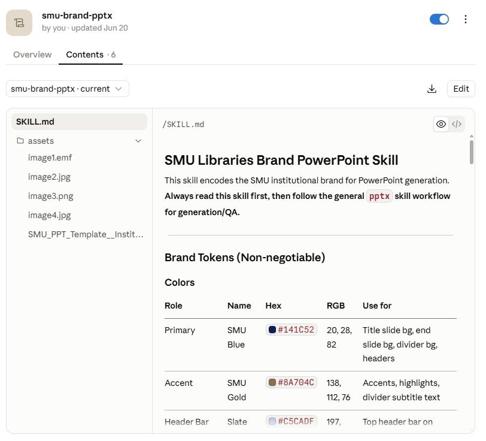

## By the end of today, you'll be able to

- Hand an AI agent a research task on **your own files**
- **Check** the sources and codes it brings back
- Turn what worked into a **procedure you can reuse and defend**

::: {.notes}
[0:00] Welcome, introduce yourself in one line (librarian at SMU Libraries, supporting researchers with data and digital tools) and thank the professor.

Then this promise, slowly. These three lines are the whole session: Parts 1 and 3 are the first line, Part 2 and the human coding check in Part 3 are the second, Part 4 is the third.

While people settle: "If you haven't opened Claude Code or Codex yet, start it now. The first hands-on bit is in about 25 minutes."
:::

## Today

1. Core concepts, and a tour of Claude Code / Codex 
2. Finding and checking sources for a literature review
3. Coding with a codebook: field notes, then a whole chat export
4. Making it reproducible and defensible: logs, Skills, integrity


::: {.notes}
The overarching idea for the whole session: what can the AI reach, and how do you steer it?

Say it out loud and slowly. It's the question we come back to at every section break.

Walk through the parts in one breath each:

- Part 1: what an agent is, and a short tour of the tool.
- Part 2: using it to find sources, and checking them.
- Part 3: coding field notes with a codebook, you and the AI, then the same logic on the group's whole chat export.
- Part 4: making sure you can repeat it and defend it, ending with the integrity checks.

Then the close.

Run sheet (core ends by 8:30; anything after is bonus):

- 6:30–6:38 Opening and calibration
- 6:38–7:03 Part 1 and first task
- 7:03–7:23 Part 2: literature discovery and checking
- 7:23–7:28 Short break / reset (use it as buffer if behind)
- 7:28–8:03 Part 3: field-note coding, human check, then scale
- 8:03–8:30 Part 4: logs, reproducibility, Skills, then integrity and take-home (integrity starts by 8:23)
- After 8:30, if the room has time: questions, live Skill demo, Git, troubleshooting

If time slips, cut in this order: Remote/SSH (already gone) → modes table (just say "start in Plan") → live connector setup → "Level up" → live Skill creation (show the finished SKILL.md).

Never cut: the first task, checking real references, Try 3 (code it yourself), the "before you give it research material" slide, the research log, the final accountability line.
:::


## A note before we begin

- **Practitioner-led**: what I've learned supporting researchers
- Tools change **fast**, so today's focus is on the **mental model**
- For study-specific methodological decisions, follow your faculty and ethics guidance

::: {.keypoint}
Questions and corrections welcome. Let's make it two-way exchange!
:::

::: {.notes}
[~30 sec] Keep this short. The essential version: "I support researchers using data and digital tools. Today is practitioner-led, not a research-methods lecture. Tools will change, but the questions of access, steering, verification and accountability will stay."

The full version of each point, only if the room wants it:

- Practitioner-led: this is based on what I've learned from experimenting with these tools in my day-to-day work supporting researchers.
- The tools and practices are evolving quickly. Some of what I show will look different by next semester, and some of you may know parts of it better than I do. Today is about a mental model that should survive the next few product updates.
- Anything related to research methods is strictly in the domain of your professor.
- Questions, corrections and lessons from your own experiments are welcome.

Or paraphrase:

"I'm not a methods person and I'm not selling a product. I support researchers, and I've spent a lot of time breaking these tools so you don't have to. Menus will change. The way of thinking about them shouldn't."

On methods: "If anything I say about method conflicts with what your professor says, your professor wins."

:::


## Where are you now?

Quick show of hands:

::: {.incremental}

1. I've used ChatGPT, Claude, Gemini or Copilot **at least once**
2. I use one of them **every week**
3. I've connected one to **another app** (Drive, Zotero, a database)
4. I've had one **run code** or **edit files** for me

:::

::: {.notes}
[~1 min] Ask each one and keep hands up as you go. Expect most hands on 1 and 2, a few on 3, very few on 4.

Read the room out loud: "So most of us are here [1–2]. Today is about getting from here to here [3–4]."

If many hands go up on 4, say you'll go faster through the tour and spend more time on Parts 3 and 4.
:::


## Checklist

Ideally, before today you have:

- ✓ **Claude Code** or **Codex** installed and logged in (both need a paid plan)
- ✓ Laptop and charger

<br>

No Claude Code or Codex? Please pair up with someone who has it. 

If pairing, one person drives and the other checks the plan, permissions, and output. Swap when useful.

::: {.notes}
[~30 sec] Say it quickly; don't read the list.


:::

## A ground rule

::: {.big}
If you can't defend it without the AI in the room, you're not done.
:::

::: {.notes}
[~30 sec] Read it, then pause. Let it land.

"Imagine your examiner or a reviewer asks: why did you include this paper, why is this code applied here? 'Claude said so' isn't an answer. Everything today is about getting to an answer you can give yourself."

This line comes back at the very end.
:::


# Part 1: Core concepts {.section}


::: {.notes}
[~0:08] Part 1, about 25 minutes, including a 5-minute hands-on.
:::

## Words I'll use {.smaller}

| Term | What I mean |
|---|---|
| **Model** | The AI itself (Claude, GPT). Reads text, writes text |
| **Harness** | The app around the model (Claude Code, Codex, claude.ai). Decides what it can see, touch and run |
| **Agent** | Model + harness, working through a task in steps. You set the task and check the work |
| **Context** | Everything the model can see in this session. Not long-term memory |
| **Tool** | One action the harness allows: read a file, run code, search |
| **Connector (MCP)** | A plug-in that lets the agent search an outside source: PubMed, Zotero, Drive |
| **Skill** | A saved prompt for a recurring task, in a `SKILL.md` file |

::: {.notes}
[~2 min] Don't read the table. Say: "These words get used loosely online. Don't memorise them; the first activity makes them concrete, and I'll point back."

Make only two points, then move on:

- Model vs harness. Same model in claude.ai and in Claude Code; the harness is what changes what it can do. That's the whole "chat vs agent" difference coming up.
- The one-liner: "The harness gives it tools, connectors give it reach, Skills give it your method."

Context gets its own slide later (the desk). Connectors and Skills get their own slides at the end of Part 1.
:::

## What can the AI reach, and how do you steer it?

Most of us are familiar with the **I type, it answers** pattern.

Three new ideas today:

| Capability | The idea | What it means for you |
|---|---|---|
| **It can act** | Agents plan and take steps, not just a quick reply | Hand over a task instead of a question |
| **It can reach things** | Connectors extend access to outside services and sources | Results retrieved from identifiable sources, not only model memory |
| **It can follow your procedures** | Skills hold your instructions / prompt | The same documented instructions every time |

::: {.notes}
[~2 min] This slide is the map for the whole session.

- "It can act": that's the agent idea, the next few slides.
- "It can reach things": connectors, end of Part 1, used in Part 2.
- "It can follow your procedures": We use a prepared Skill in Part 3, then revise and generalise it together.

"Steering" is the right-hand column: you decide the task, the sources and the procedure.
:::

## Chat vs agent

::: {.columns}
::: {.column width="50%"}
### A chatbot
is like a **colleague on the phone**.

- Can advise, draft and explain, sometimes very well
- Only sees what you read out, paste, or upload
- Can't open your files or run anything: You still carry files and outputs back and forth
:::
::: {.column width="50%"}
### An agent
is like a **research assistant at your desk**.

- Can open your files and use your tools
- Works through several steps on its own
- Reports back, and you check the work
:::
:::

::: {.notes}
Same underlying model in both cases. What's different is what it's allowed to touch and whether it can take more than one step before coming back to you. In glossary terms: same model, different harness.

[~2 min] The contrast is access, not effort or intelligence. A brilliant colleague on the phone still only knows what you tell them, and you still do the copying, pasting and running. Sit them at your desk and they can open the files themselves.

Lean on the analogy: most people here have supervised or been an RA. "You wouldn't take an RA's literature table without spot-checking it. Same here."

The "desk" comes back on the context slide.
:::

## In practice: web chat vs Claude Code / Codex

| Web chat (Claude.ai / ChatGPT.com) | Claude Code / Codex |
|---|---|
| Runs in a browser | Runs on **your computer**, in **your project folder** |
| Sees only what you paste or upload | Reads files directly from the project folder and can examine how they relate |
| Hands you text and code to copy back | Creates, edits and organizes files itself |
| You run the output yourself | Runs scripts and commands, **with your permission** |
| Best for questions and one-off outputs | Best for multi-step work i.e. act, check, continue |

::: {.notes}
[~1.5 min] Don't read the table row by row. Pick two rows:

- "Runs on your computer, in your project folder." That's the big shift.
- "Runs scripts, with your permission." That's why we'll talk about modes in a minute.
:::

## More access, not "better"

::: {.caution}
Claude Code and Codex aren't automatically **better** than web chat. They have more **access** and more ability to **act**, which is why permissions, checkpoints and your review matter even more.
:::

::: {.notes}
[~30 sec] Say it plainly: more access means more ways for things to go wrong. Web chat is still the right tool for a quick question.

This is the fence for the whole session: an agent isn't a smarter chatbot, it's the same model with more reach.
:::

## Before you give it research material {.smaller}

| Ask | Think about |
|---|---|
| **May I use it?** | Consent, IRB/ethics approval, platform expectations, confidentiality |
| **May this tool receive it?** | Institutional approval, provider terms, retention and training settings |
| **What's the minimum it needs?** | De-identify, minimise, aggregate, or use fictional / synthetic material |
| **What must stay with me?** | Interpretation, contextual judgement, inclusion decisions, final claims |

::: {.caution}
**"Local" ≠ private.** While the files stay on your machine, remember that what the agent reads is sent to the model provider.

**Public ≠ unrestricted.** Publicly visible posts aren't automatically ethically unrestricted, context-free, or fine to send to a third-party model.
:::

::: {.notes}
[~2 min] This comes before any tool demo on purpose. For ethnographers, ethics isn't a closing caution; it decides whether the workflow should happen at all.

Walk the four questions top to bottom. The first two are "should this go in at all?", the third is "how little can I send?", the fourth is "what never gets handed over?".

On "public ≠ unrestricted": "Most of you will hear 'but it was public' from someone this year. Public to the group members who posted it is not the same as public to a model provider." Defer specifics to the professor and your IRB.

Everything we use today is fictional, written for teaching, so we can skip the first three questions. With your real field notes, you can't.
:::

## The agent loop

```{=html}
<div style="display:flex;gap:0.5em;align-items:stretch;font-size:0.7em;margin-top:1em">
  <div style="flex:1;border:2px solid var(--ocean);border-radius:var(--radius-md);padding:0.6em;background:var(--surface-raised)"><b>Plan</b><br>Break the task into steps</div>
  <div style="align-self:center">→</div>
  <div style="flex:1;border:2px solid var(--ocean);border-radius:var(--radius-md);padding:0.6em;background:var(--surface-raised)"><b>Act</b><br>Search, read a file, run code</div>
  <div style="align-self:center">→</div>
  <div style="flex:1;border:2px solid var(--ocean);border-radius:var(--radius-md);padding:0.6em;background:var(--surface-raised)"><b>Observe</b><br>Look at what came back</div>
  <div style="align-self:center">→</div>
  <div style="flex:1;border:2px solid var(--ink);border-radius:var(--radius-md);padding:0.6em;background:var(--mist)"><b>Adjust</b><br>Fix, retry, or move on</div>
  <div style="align-self:center">↺</div>
</div>
```

<br>

- A conventional chat exchange presents **one** response at a time. 
- An agent can continue acting, observing, and adjusting across a task until it **thinks** it's finished.
- That said, **you** decide when it's actually finished.

::: {.notes}
We'll see the loop live in Part 3, when the script hits an error and the agent fixes it. Point back to this slide then.

[~2 min] Example to talk through: "Find the CSV, count the rows. Oops, the year column has text in it. Clean that, count again."

Stress the second bullet. Agents are confident about being finished. That's where you come in.
:::

## Context: the agent's working memory

Think of **context** as the agent's desk.

- Everything goes on the desk: instructions, files, results, replies
- The desk is **big but not infinite**
- Long sessions may **drift** and early rules may get buried

::: {.keypoint}
**Habits:** fresh session per task · instructions in a **file** · ask for a progress summary
:::

::: {.notes}
[~2 min] Back to the desk from the chat-vs-agent slide.

The full version: everything in the session sits on the desk (your instructions, files it read, search results, its own replies). As the pile grows, early instructions get buried, which is why it "forgets" a rule you set an hour ago. Put important instructions in a file (or a Skill), not in message 3 of 40.

Ask: "Has anyone had a long chat where it started ignoring something you told it earlier?" Expect nods. That's context.

The habit that matters most for researchers: write instructions in a file. It's also the bridge to Skills later.
:::

## Where the code runs

The useful question isn't "which product?" but **where does it run, and what can it touch?**

| Option | Where it runs |
|---|---|
| **Local** | Your computer: your files, your terminal. The default option and what we use today |
| **Cloud** | The provider's machine. Good for long tasks; starts from a fresh copy, so it can't see your local folders |

::: {.notes}
[~1 min] Back to "what can it reach?": the answer depends on where it runs.

Today: local. Cloud is worth knowing about for long jobs, but it can't see your laptop's folders.

Either way, the content it reads goes to the model provider (previous "before you give it research material" slide).

If someone asks about lab servers: both tools can also run on another machine over SSH. Not needed today.

If people ask where to pick local vs cloud, show the menu live in the app. No screenshot on purpose: the menus keep moving.
:::

## Tour: how much should it ask you?

| Mode | What it does |
|---|---|
| **Plan** | Investigates and writes a plan **before** changing anything |
| **Manual** | Asks before every action that changes something |
| **Accept edits** | File edits go through; other actions still ask |
| **Auto** | Proceeds on safe actions, pauses on riskier ones |
| **Bypass** | Never asks. **Not for today** |

::: {.notes}
Codex calls these approval settings: Ask for approval, Approve for me, Full access. Same idea.

[~1.5 min] This is "how do you steer it?" Modes are a dial from "check everything" to "trust everything".

If running behind: skip the table, go straight to the next slide and just say "start in Plan".
:::

## Tour: start in Plan mode

::: {.big}
For research work, start in **Plan mode**.
:::

Read the plan the way you'd read a research assistant's proposal, then let it act.

::: {.notes}
[~1 min] Show where the mode switch is in the app, live (no screenshots on the slide: the UI changes too often). Everyone set Plan mode now, ready for the next slide.

Claude Code: the mode picker next to the message box. Codex: the approvals setting. Check both the week before in case they've moved.
:::

## Tour: first task {.activity background-color="var(--mist)"}

[5 min · Plan mode]{.chip .chip-try}

Open the workshop folder in Claude Code or Codex, then:

```text
Look at fieldwork-log.csv. Count my fieldwork entries by month and
type, make a bar chart, and save it as fieldwork-by-month.png. Then
add a two-line note to README.md saying what you did and when.
```

Look for:

- It **plans** before acting
- It **reads** the actual file instead of guessing
- It **leaves things behind**: a chart and a note, in your folder

::: {.notes}
Show-and-tell fallback: I run it on screen. Keep to 5 minutes. Don't teach terminal commands; the desktop apps avoid most of that. The point is: an agent on your own machine works on your files and leaves a record.

The file is materials/data/fieldwork-log.csv: a fictional fieldwork log for the same Telegram hawker group as the field notes (40 entries, March to May 2026, columns fieldnote_id, date, site, type, minutes). FN-01 to FN-06 match the excerpts in fieldnotes.csv. Expected result: March 9 entries, April 17, May 14; mostly observation, a few archive and interview.

Frame it: "This is the kind of file you already keep. The agent is working on your records, not the internet."

Start the timer. Walk around. Common snags: folder not opened, not logged in, permission prompt they don't understand ("say yes, it's asking to write a file").

When the time is up, ask one person: "Did it plan first? Did you approve the plan?" Then open the chart and the README on screen.

Name what they just met, pointing back to the glossary: the model wrote the plan, the harness asked your permission, reading the CSV and saving the chart were tools, and the CSV was on its desk (context).
:::

## Connectors: USB-C ports for AI


- A **connector** plugs the AI into a source: a scholarly index, Google Drive, or Zotero
- **MCP** (Model Context Protocol) is the **standard** behind them, like USB-C is the standard behind the cable
- You don't need to build one. You need to know they **exist** and what each one can **reach**

## Connectors: why they help

**Without a connector:** without access to a retrievable source, it may rely on model knowledge, which can be outdated or wrong.

**With a connector:** it searches a live source and can show you **where** each result came from.


::: {.caution}
A connector acts **with your access**. A word of caution: Treat it like a browser extension and check who made it before you switch it on.
:::

::: {.notes}
Claude Code: connectors added to your claude.ai account are available when you log in with that account; you can also add MCP servers per project. Codex: MCP servers are added in its settings. Check both the week before.

[~3 min] The key line: "You don't need to build one." People hear "protocol" and switch off. If running behind, skip the live setup mechanics; the setup steps are in the materials.

Stress the right column: memory vs a live source. That's the whole of Part 2 in one contrast.
:::

## Skills: a saved prompt that can act {.smaller}

**Before:** keep your best prompts in a doc, paste them into the chat every time.

**Now:** save it once as a Skill, call it by name, and the agent **works through the steps**, reading files and running scripts as it goes.

| Pasted prompt | Skill | Python script |
|---|---|---|
| Retyped, drifts each time | Saved once, same instructions every run | Same code every run |
| Text only | Uses the agent's tools, can bundle scripts | Does exactly what's written |
| Flexible, hard to repeat | **Flexible, with repeatable instructions** | Most deterministic, least flexible |

::: {.keypoint}
Not as fixed as a python script, but it can deal with the messy case a script can't. Useful for things like **coding scheme** or **screening criteria**.
:::

::: {.notes}
Just plant the idea here. We use one in Part 3 and build one at the end of Part 4.

[~2 min] Tell your own story: "I used to keep my prompts in a doc and paste them in every time. Now I save them as a Skill and just call it."

Precisely: a Skill doesn't give the agent new abilities. It uses the tools the harness already has (read files, run code, connectors), and it can bring its own scripts and reference files along. That's why it can do steps, not just answer.

The middle column is the point: more repeatable than a pasted prompt, more flexible than a script. Pick a script when you need the identical result every time (counting, filtering); pick a Skill when the task needs judgement, like applying a codebook.

For this audience: "You already write coding guides for human coders. A Skill is the same document, written for the AI."

Recap Part 1 in one line before moving on: an agent acts, connectors let it reach things, Skills steer it.
:::

# Part 2: Finding and checking sources for a literature review {.section}


::: {.notes}
[~0:33] Back to the question: what can it reach? Now we point it at the literature.
:::

## Why connectors matter for a lit review

Ask a plain chatbot for references and you'll often get:

- Real authors, plausible title, **paper doesn't exist**
- Real paper, **wrong year or wrong journal**
- Real paper, but it **doesn't say what the AI claims**

::: {.caution}
A connector improves **provenance**: you can see where a result came from. It doesn't show that the source **supports the claim**. Finding, coverage and interpretation are separate checks.
:::

::: {.notes}
[~2 min] Three ways a reference goes wrong, from most to least obvious. The third is the dangerous one: the paper exists, so a quick check passes, but it doesn't support the claim.

The caution box is the headline for Part 2. Don't let anyone leave with "connector = safe literature search". A connector fixes the first problem (made-up papers) far more than the third (papers that don't say what the AI claims).

If you have a real (anonymised) example from a consultation, tell it here. A story beats the bullet list.
:::

## What can it reach?

| Source | Covers | Connect via |
|---|---|---|
| **PubMed** | Biomedical and life sciences | Connector directory |
| **Consensus** | Broad, built on Semantic Scholar / OpenAlex data | Connector directory |
| **alphaXiv** | arXiv preprints | Connector directory |
| **Zotero** | **Your own** saved library | Community MCP server |
| **Your library's databases** | Licensed content (Scopus, WoS, publisher platforms) | Mostly **not** reachable. Use the library |

::: {.keypoint}
For advanced users: an open API such as OpenAlex can also be incorporated into a custom workflow.
:::


::: {.notes}
Library angle worth stressing: connectors mostly reach open indexes. Paywalled full text and licensed databases are usually out of reach, so "the AI didn't find it" often means "the AI couldn't see it". The library's discovery tools and librarians are still part of the workflow.

[~2 min] For ethnographers specifically: a lot of the relevant work is in books, edited volumes and regional journals, which open indexes cover poorly. Expect gaps.
:::

## How to switch on a connector {.smaller}

::: {.columns}
::: {.column width="50%"}
### Claude Code

1. In a browser, go to **claude.ai/customize/connectors**
2. Find the connector (e.g. Consensus, PubMed) → **Connect**, and sign in if asked
3. In Claude Code, type **`/mcp`** and check it says **Connected**

Missing? Type `/status`: you need to be logged in with your **claude.ai account**, not an API key.
:::
::: {.column width="50%"}
### Codex

1. Find the service's **MCP server address** on its website or docs
2. Codex app: **Settings → MCP servers → Add server** → a name and the address → **Save** → **Restart**
3. In Codex, type **`/mcp`** and check it's listed

In a terminal instead: `codex mcp add <name> --url <address>`
:::
:::

[Menus change often. Checked October 2026 against the Claude Code and Codex docs.]{.small .muted}

::: {.notes}
[~30 sec] Reference slide, for later. Don't read it: do it live once in the demo on the next slide, and tell them "the steps are on this slide for when you get home."

Claude side: connectors added on claude.ai show up in Claude Code automatically when you're logged in with that account. They don't load if you've logged in with an API key.

Codex side: there's no shared directory in the same way; you add each server by its address. Some ask you to sign in the first time (codex mcp login <name>).

If running behind: skip straight to the demo.
:::

## Demo: explore with a connector

::: {.demo}
Connector on: Consensus (or PubMed for health topics).
:::

```text
Find recent (2020 onwards) peer-reviewed papers that use digital
ethnography to study online communities.

Return a table: citation, year, type (empirical / review / methods /
opinion), and a one-sentence finding. Give the DOI for each.
Only include papers you actually retrieved from the search.
Do not fill gaps from memory. Tell me which source each came from.
```

::: {.notes}
Point out the guardrails in the prompt: "only include papers you actually retrieved" and "which source". Open two DOIs live.

[~4 min] While it runs, read the prompt aloud and underline the last three lines: those are the steering. Point out the "type" column: a small classification task, which Part 3 does properly with a codebook.

If the connector is slow or down: switch to the recorded run.
:::

## Discerning, not just finding {.smaller}

The connector finds things. **You** still judge them.

::: {.columns}
::: {.column width="50%"}
**Is it real and is it right?**

- Does the DOI resolve to this paper?
- Right authors, year, venue?
- Does the paper actually say the one-line finding?
:::
::: {.column width="50%"}
**Is it any good for my purpose?**

- Peer-reviewed or preprint?
- Retracted or corrected? (Check Retraction Watch / the publisher page)
- Reputable venue, or a questionable one?
- Relevant to **my** question, or just similar wording?
:::
:::

::: {.keypoint}
Ask the AI to help with the second column too ("flag preprints and anything you can't confirm is peer-reviewed"), then spot-check its flags.
:::

::: {.notes}
[~2 min] Left column: is it true? Right column: is it useful? The AI can help with both, but you're the one who signs off.

"Relevant to my question, or just similar wording?" is the one people skip. Search matches words, not meaning.

This slide is the checklist for the activity that comes next.
:::

## Try 2: check a reference from your topic {.activity background-color="var(--mist)"}

[TRY · 5 min · pairs]{.chip .chip-try}

1. Run the discovery prompt with **your own topic**
2. Pick **one or two references** and open them:
   - Does the DOI or link open **the paper the table names**?
   - **Right** authors, year and venue?
   - Does the paper actually **say the one-line finding**? (Read the abstract at least)
   - **Peer-reviewed**, preprint, or retracted?

::: {.notes}
If some people have no connector set up, pair them with someone who does: the contrast in invented references is usually striking.

Show-and-tell fallback: I run it once with a connector and once without, on a volunteer's topic, and we check three refs together on screen.

Start the timer. Remind them: the prompt is in the online slides, so copy it rather than typing it.

:::

## Discussion: your result {.discuss background-color="var(--surface-raised)"}

[DISCUSS · 5 min]{.chip .chip-talk}

- Does your reference check out?
- What do you **know** exists on your topic that didn't show up? Why might that be?
- Which check changed your level of trust most?

::: {.notes}
Spend most of the time on the second question. It brings back the coverage point: books, non-English work and paywalled journals are often invisible.

Close: "So the connector is a good start for finding things. It doesn't replace your judgement, or the library."

Then plant the refrain for the rest of the session: "Show me where that came from." For a reference, that's the DOI and the passage. In Part 3 it'll be the exact words in a field note.
:::

# Part 3: Coding with a codebook {.section}

::: {.notes}
[~0:58] Part 2 was about checking other people's writing. Now we move to our own material: fictional field notes and chat messages. We will code by hand, compare our decisions with an AI, improve the written procedure, and only then test whether that procedure can scale.
:::

## Where AI coding fits

::: {.columns}
::: {.column width="50%"}
### Good first cut
**Deductive coding:** you already have a codebook and want to apply it.

Useful for sorting, tagging, and applying stated definitions across larger collections.
:::
::: {.column width="50%"}
### Use with greater caution
**Inductive or interpretive work:** building themes from scratch and reading what is not said.

Here, your judgement *is* the method.
:::
:::

::: {.big}
A fast, literal research assistant: useful for a first cut, shaky on subtext.
:::

::: {.notes}
[~1.5 min] Everything we do next is deductive: a codebook already exists, and we ask the AI to apply it.

Emphasise "first cut". You still check it, as you would check another coder. If asked about inductive coding: an AI can propose candidate themes for the researcher to react to, but the reported interpretation must come from the researcher's reading and argument.
:::

## What the studies found {.smaller}

| Study | What they did | What they found |
|---|---|---|
| Xiao et al. (2023) | Expert codebook + GPT-3 on children's questions | Fair to substantial agreement with expert coders |
| Chew et al. (2023) | LLM-assisted content analysis on four public datasets | Often comparable to human coders; also exposed codes the model was only **guessing** |
| Gilardi et al. (2023), *PNAS* | ChatGPT annotating about 6,000 tweets and news articles | Outperformed crowd workers on the tasks examined |
| Pangakis et al. (2023) | GPT-4 replicating 27 coding tasks from published studies | Good on some tasks, poor on others: **validate every task** |
| De Paoli (2024), *SSCR* | GPT-3.5 doing inductive thematic analysis of interviews | Recovered many themes from the original studies; exploratory |
| Ashwin et al. (2025), *SMR* | LLM coding of Rohingya refugee interviews | Errors were **not random**: they varied with who was speaking |

::: {.notes}
[~2 min] Do not read the table. Use three rows:

- Chew et al.: deductive coding with a codebook can approach human agreement, which is what we are about to test.
- Pangakis et al.: success in one published study does not validate the method for your task or data.
- Ashwin et al.: the model's errors aligned with characteristics of the people interviewed. For ethnographers, that can bias findings rather than merely add noise.

If running behind, skip the slide and point students to the reading list.
:::

## A codebook, written for the AI {.smaller}

Six fictional field notes from a Singapore hawker-food Telegram group, coded with **boyd's networked-publics affordances**:

| Code | Apply when | Not when |
|---|---|---|
| `persistence` | Old posts resurface; content cannot be deleted; people refer back | Memory or nostalgia alone |
| `visibility` | Who can see it; public versus private; audiences collide | Content is simply posted |
| `spreadability` | Forwarding, reposting, screenshots, or cross-posting | Content is viewed but not moved |
| `searchability` | Platform search shapes what is findable | Looking something up offline |
| `other: ...` | Something these codes miss and you can **name** | A dumping ground |

**Rules:** quote the **exact words** for every code · "nothing fits" is allowed · flag anything identifying

[Full codebook: `materials/skills/qual-coding/SKILL.md` · notes: `materials/data/fieldnotes.csv`]{.small .muted}

::: {.notes}
[~2 min] "You already write documents like this for human coders. This is the same procedure written so an AI can follow it too."

Point out the "Not when" column. That is where much of the judgement lives. The exact-words rule repeats the Part 2 question: show me where that came from.
:::

## Try 3: code it yourself first {.activity background-color="var(--mist)"}

[TRY · 7 min · alone · no AI]{.chip .chip-try}

```text
[FN-02] 6 Mar, 12.30pm. A new member asked whether a char kway teow
stall at a hawker centre in Ang Mo Kio is "still good". Three people
replied with links to old messages in the group from 2023. One wrote
"scroll up lah, we discussed already". The new member said the search
bar "doesn't find anything" when she types the stall name in Chinese.

[FN-04] 19 Mar, 7.05pm. The Instagram account reposted a member's
review without crediting them. The member complained in the Telegram
group: "I wrote it for the group, not for IG." Admin apologised and
said they would "ask first next time". Several members reacted with
the thumbs-up emoji; one wrote "but the IG is public what, anyone
can see anyway".
```

For each decision: **excerpt · code · exact words · confidence** (high / medium / low)

You do not need to identify every possible code. Make one or two defensible coding decisions for each excerpt.

::: {.notes}
Everyone can do this activity, with or without a paid tool. Reviewers in each pair should code too.

At five minutes: "Two minutes. Make sure every code has a quotation."

Do not reveal your own coding. The students' readings establish the human baseline.
:::

## Skills, briefly

A **Skill** is the written procedure from Part 1, saved so the agent can apply it again.

For this task, it preserves:

- the code definitions and exclusions;
- the required evidence and confidence;
- the permission to say **"nothing fits"**;
- the identifying-information flag;
- the output structure.

::: {.keypoint}
The Skill does **not** make the coding valid or deterministic. It preserves the instructions we want to test.
:::

::: {.notes}
[~1 min] This is a bridge, not a technical lesson. Show the prepared `SKILL.md` briefly if useful. Do not discuss paths or automatic triggering yet.

Say: "I prepared this Skill before the session because I wanted you to interpret the excerpts before watching me build software. It contains the same codebook and rules you just used."
:::

## Demo: the Skill codes the same notes

(using qual-coding-networked-publics)

```text
/qual-coding-networked-publics
Code fieldnotes.csv. Quote the exact words for every code.
If nothing fits, say so.
```

**Look for:**

- First compare its decisions for **FN-02** and **FN-04** with yours.
- Does every code have a **verbatim** quotation?
- Where is confidence **low**? What went into **`other:`**?
- Did it raise an **ethics flag**? (Hint: FN-03)

::: {.notes}
[~4 min] Run the prepared Skill. Scroll to FN-02 and FN-04 first so students can compare its decisions with their own. Then inspect FN-03 for the identifying-information flag. Finally open coded-fieldnotes.csv, which the Skill saves next to the input: one row per code, the same shape the chat-export demo will produce.

If the run is slow or fails, open `materials/sample-ai-output.md`. The interface is incidental; the coding decisions are what the class needs to inspect.
:::

## Discussion: you vs the AI {.discuss background-color="var(--surface-raised)"}

[DISCUSS]{.chip .chip-talk}

- Where did you **disagree**: your reading, its reading, or the **codebook**?
- What did it **miss**: irony, context, tone, platform vernacular, or what is absent?
- What **one line** would you add to the codebook?

::: {.keypoint}
**Agreement is not interpretive validity.** A model can apply a code consistently and still miss context, positionality, platform vernacular, or what is absent from the record.
:::

::: {.notes}
Two minutes in pairs, then three minutes as a room.

Each AI code receives one human decision in the audit log: accept, reject, or modify, with a reason.

Collect two or three proposed codebook changes. Choose one and type it into the codebook live. This creates the reason for the next slide: we tested a procedure, found a weakness, and now preserve the revision.
:::

## Build together: turn the codebook into a Skill

[BUILD TOGETHER · follow along if useful]{.chip .chip-learn}

```text
/skill-creator
Revise the qualitative-coding Skill using the codebook clarification
we just agreed. Then generalise it as a Skill called code-with-codebook.

It should ask for:
- a codebook with each code's definition, when to apply it, and when not to;
- a CSV containing an ID column and a text column.

For every coding decision, save: id, code, verbatim evidence,
confidence, rationale, and an identifying-information flag.
"Nothing fits" is allowed. Log the model, date, input files and
number of rows in research-log.md.
```

We tested the procedure, improved it, and saved the revision.


::: {.notes}
[~5 min] This is not "building a Skill because Skills are interesting." It is preserving a procedure the class has just tested and revised.

Say explicitly: "The Skill is not what makes the method defensible. The codebook, evidence, human checking and decision record do. The Skill preserves the revised instructions."

Show the resulting `SKILL.md`, but do not spend time teaching folder paths. If the live creation is slow, open the prepared revised version and compare the changed rule.
:::

## Try 4: test your Skill on a small batch

[TEST · first 20 rows only]{.chip .chip-try}

```text
/code-with-codebook
Use the codebook in codebook.md to code messages.csv.
The ID column is message_id and the text column is text.
Process the first 20 rows only, save the results as coded-sample.csv,
and add the run to research-log.md.
```

**Before scaling, inspect:**

- Are the output fields complete?
- Does each code have verbatim evidence?
- Which cases are low-confidence or unclear?
- Did the revised codebook line change the relevant decisions?

::: {.notes}
[~3 min] The habit is: test a small batch before spending money and time on the full archive.

If the run is slow or misbehaves, use the prepared output. Transition: the Skill holds the judgement-rich instructions; next we add a script for the checks that have one right answer.
:::

## Same logic, at scale

::: {.columns}
::: {.column width="50%"}
### Six field notes
**Coding side by side with another coder**

You, the AI and a codebook can discuss each note.
:::
::: {.column width="50%"}
### The whole digital export
**Applying the procedure across an archive**

The Skill codes every message; a script checks the output and logs the run.
:::
:::

<br>

Same method: **codebook → AI codes → human check → revise → test again**.

::: {.notes}
[~1 min] The Skill holds the judgement-rich procedure. The script checks what it produced. They are complements, not competitors.

Do not say that the script makes the interpretation certain. It makes the checks repeatable; the model's coding may still vary.
:::

## Skill, script, or hybrid? {.smaller}

::: {.columns}
::: {.column width="33%"}
### Skill
Best when the task needs interpretation:

- apply definitions;
- extract evidence;
- explain rationale;
- flag uncertainty.

**Repeatable instructions; outputs may vary.**
:::
::: {.column width="33%"}
### Script
Best when the operation can be fully specified:

- filter and deduplicate;
- sample with a seed;
- validate columns;
- calculate agreement;
- make tables and charts.

**Fixed code for fixed operations.**
:::
::: {.column width="33%"}
### Hybrid
For judgement at scale:

- Skill or codebook defines the method;
- script validates, samples and logs;
- model proposes codes;
- researcher reviews disagreements.
:::
:::

::: {.notes}
[~2 min] This is the conceptual distinction students need before the Python demonstration.

Use ordinary code when ordinary code can answer the question. For example, selecting every row where `forwarded = yes` should be a filter, not an LLM task.
:::

## At scale: code everything, check it with a script

[WATCH THE WORKFLOW · no Python knowledge required]{.chip .chip-learn}

The first 20 looked right, so the Skill codes all 210 messages. Then:

```text
Write a Python script that checks coded-messages.csv against
messages.csv: every message_id appears at least once, every row
has id, code, evidence and confidence, and every evidence quote
appears word for word in the original message. Run it, list any
problems, and log the date and result in research-log.md.
```

**Watch for:** plan → write → run → inspect → adjust → rerun

::: {.notes}
[~4 min] Two steps. First run /code-with-codebook on all of messages.csv, saving coded-messages.csv (start it during the previous slide if it's slow). Then the check script.

The Skill does the judgement; the script does the checks that have one right answer. That's the hybrid from the last slide.

The verbatim check is "show me where that came from", automated: a quote the model paraphrased or invented gets caught by code that gives the same answer every time. If it finds problems, good: that's the point of checking.

Students do not need to reproduce the Python. Ask them to watch the decision structure: write, run, inspect, adjust. The script makes the checks repeatable; it does not make the model's coding deterministic.

If an error occurs, use it to illustrate the agent loop. Do not promise or manufacture an error.
:::

## At scale: compare with human coding

```text
Compare the AI codes for the 30 messages in hand-codes.csv with my
codes in that file. Summarise agreement for each code and list every
mismatch with the message, both coding decisions, and a possible reason.
```

- The statistic is a summary; the **mismatches** tell us what to inspect and revise.
- A message isolated from its thread can lose crucial context.
- Human coding is a comparison point, not an unquestionable gold standard.

::: {.notes}
[~3 min] Read one mismatch and ask the room: researcher, AI, both, or neither?

If discussing Cohen's kappa, define it briefly as agreement corrected for chance, then return attention to the disagreements and their causes.
:::

## Making AI coding defensible

| Move | What it looks like |
|---|---|
| **Validate against human coding** | Hand-code an appropriate sample, compare, and inspect disagreements |
| **Revise the codebook** | Clarify vague definitions and exclusions exposed by disagreements |
| **Route uncertainty to people** | Send low-confidence, unclear and identifying cases to manual review |
| **Document the run** | Keep the data, codebook or Skill, model/version, date, outputs and decisions |

::: {.notes}
[~1.5 min] Point back to what the class did: human baseline, Skill output, discussion, revised rule, small-batch test, and research log.
:::

## What can still go wrong

- **Privacy and ethics:** check approval and tool suitability before material goes in
- **Context loss:** one row without its thread, encounter or interview can be misread
- **Flattening:** models can favour common readings and miss minority or unexpected ones
- **False confidence:** consistent output can still rest on a poor codebook or interpretation

::: {.notes}
[~1 min] Linger on flattening. In ethnographic work, the unusual voice may be analytically important, and it is precisely what an automated first cut can smooth over.
:::

# Part 4: Making it reproducible and defensible {.section}

::: {.notes}
[~1:33] We have used a Skill for the judgement-rich procedure and a script for the fixed checks. Part 4 asks what must remain after the demonstration so the workflow can be inspected and defended.
:::

## Reproducible by design

- For fixed operations: **same data + same code + same environment → same result**
- Model-generated coding is **not deterministic**
- So preserve the procedure, inputs, outputs, settings and decisions
- For interpretive work, the immediate goal may be **transparency and auditability**, not identical interpretation

::: {.keypoint}
A seed makes a random sample retrievable, not methodologically correct by itself.
:::

::: {.notes}
[~2 min] Do not tell students that saving a script makes the AI coding reproducible. The script preserves the checks; the model's outputs may still vary.
:::

## What to keep

| Keep | Example from today |
|---|---|
| **The data** or retrieval method | de-identified `fieldnotes.csv` and `messages.csv`, with export date |
| **The procedure** | `codebook.md`, the Skill and the check script |
| **The checks** | human codes, AI codes, disagreements and agreement summaries |
| **The decisions** | accept / reject / modify decisions; codebook revisions and reasons |
| **The tool details** | model/version, settings and date run |

::: {.keypoint}
Save, inspect, reuse and describe the codebook, Skill, script and decision log. Do not rely on a chat transcript as the research record.
:::

## A light habit: dated folders + a research log

```text
2026-10-23_hawker-telegram/
├── fieldnotes.csv
├── codebook.md
├── messages.csv
├── research-log.md
├── hand-codes.csv
├── coded-messages.csv
└── check_coded.py
```

Tell the agent: **"After each step, draft a dated entry in research-log.md."**

::: {.keypoint}
**Add a reflexive note:** What did the tool make more visible? What did it flatten, obscure, or encourage you to treat as data?

Treat the agent's log as a draft. Check and correct it.
:::

## Skills: where do they live? {.smaller}

::: {.columns}
::: {.column width="50%"}
**Where the file lives**

- Project only: `.claude/skills/` in the project folder
- Across your projects: `~/.claude/skills/`
- Codex uses the same broad idea with its own skills location

The Skill is a text file you can inspect, version and retain with the project.
:::
::: {.column width="50%"}
{width="80%"}
:::
:::

::: {.notes}
[~1 min] This slide comes after students have used and revised a Skill, so the storage detail now answers a real question. Confirm current product-specific paths before delivery.
:::

## Verification and research integrity {.smaller}

::: {.columns}
::: {.column width="50%"}
**Check: show me where that came from**

- Citation → DOI and supporting passage
- Code → exact words plus note or message ID
- Count or chart → script plus input data
:::
::: {.column width="50%"}
**Record and disclose**

- Maintain the research log
- Check relevant course, journal or funder policy
- Disclose the tool, model/version, task and human review
:::
:::

::: {.caution}
**Sensitive data:** participant data, unpublished results and confidential material require appropriate approval and a suitable tool before use. **Publicly visible is not the same as ethically unrestricted.**
:::

## A disclosure, for example

> We used [tool and model] on [date] to propose provisional codes for de-identified field-note excerpts using the codebook in Appendix A. The researcher reviewed every code against the original text, revised the codebook after disagreement analysis, and retained final interpretive responsibility.

[A generic example. Adapt it to the requirements of the course, institution, journal, funder and study.]{.small .muted}

## Before you use third-party Skills and connectors

- A Skill or connector can operate with your access to files, accounts and data
- Treat it like code you did not write: **inspect it before use**
- Use sources you can inspect and trust
- Apply the same caution you would to a browser extension or executable

::: {.notes}
[~1 min] If time is short, cover this warning verbally rather than allowing it to create a second ending.
:::

## Take-home

::: {.big}
If you cannot defend it without the AI in the room, you are not done.
:::

<br>

**Hand over the task** | **Check what comes back** | **Keep the procedure**

Try next: write one repeated research task as a documented procedure. Turn it into a Skill only if useful.

Slides: [NTU Digital Ethnography guest seminar](https://bellaratmelia.github.io/ntude-2026/)

Questions? My email is **bellar@smu.edu.sg**

::: {.small .muted}
Sample field notes and chat messages in this session are fictional and were written for teaching purposes.
:::

::: {.notes}
Read the opening ground rule again, then pause.

Recap in one breath: "An agent can act. Connectors let it reach sources. Skills preserve judgement-rich instructions. Scripts handle the fixed checks. You remain responsible for defending the result."

:::

## Selected studies on AI-assisted qualitative coding {.smaller .scrollable}

::: {.small}
Ashwin, J., Chhabra, A., & Rao, V. (2025). Using large language models for qualitative analysis can introduce serious bias. *Sociological Methods & Research*. <https://arxiv.org/abs/2309.17147>

boyd, d. (2010). Social network sites as networked publics: Affordances, dynamics, and implications. In Z. Papacharissi (Ed.), *A networked self* (pp. 39–58). Routledge.

Chew, R., Bollenbacher, J., Wenger, M., Speer, J., & Kim, A. (2023). LLM-assisted content analysis: Using large language models to support deductive coding. *arXiv:2306.14924*. <https://arxiv.org/abs/2306.14924>

De Paoli, S. (2024). Performing an inductive thematic analysis of semi-structured interviews with a large language model. *Social Science Computer Review, 42*(4), 997–1019. <https://doi.org/10.1177/08944393231220483>

Gilardi, F., Alizadeh, M., & Kubli, M. (2023). ChatGPT outperforms crowd workers for text-annotation tasks. *PNAS, 120*(30), e2305016120. <https://doi.org/10.1073/pnas.2305016120>

Pangakis, N., Wolken, S., & Fasching, N. (2023). Automated annotation with generative AI requires validation. *arXiv:2306.00176*. <https://arxiv.org/abs/2306.00176>

Xiao, Z., Yuan, X., Liao, Q. V., Abdelghani, R., & Oudeyer, P.-Y. (2023). Supporting qualitative analysis with large language models: Combining codebook with GPT-3 for deductive coding. *IUI '23 Companion*. <https://arxiv.org/abs/2304.10548>
:::

::: {.notes}
Backup slide, after Take-home. Don't present it; it's there for anyone flipping through the slides later. Same list, with notes, in materials/reading-list.md.
:::

## Never paste API keys into chat

- Some APIs require a **key**
- A key pasted into chat, code or a shared folder can be copied, misused and billed to you
- Keep it outside the script, such as in an environment variable or an excluded `.env` file

```python
import os
api_key = os.environ["ANTHROPIC_API_KEY"]
```

::: {.caution}
If the folder may be shared or committed to Git, exclude `.env`. If a key has been exposed, revoke it and create a replacement.
:::

::: {.notes}
Backup slide, after Take-home. Not presented: there's no API demo today. It's here for anyone who goes on to use an API (the Claude API, Scopus, a publisher API) after the session.
:::
